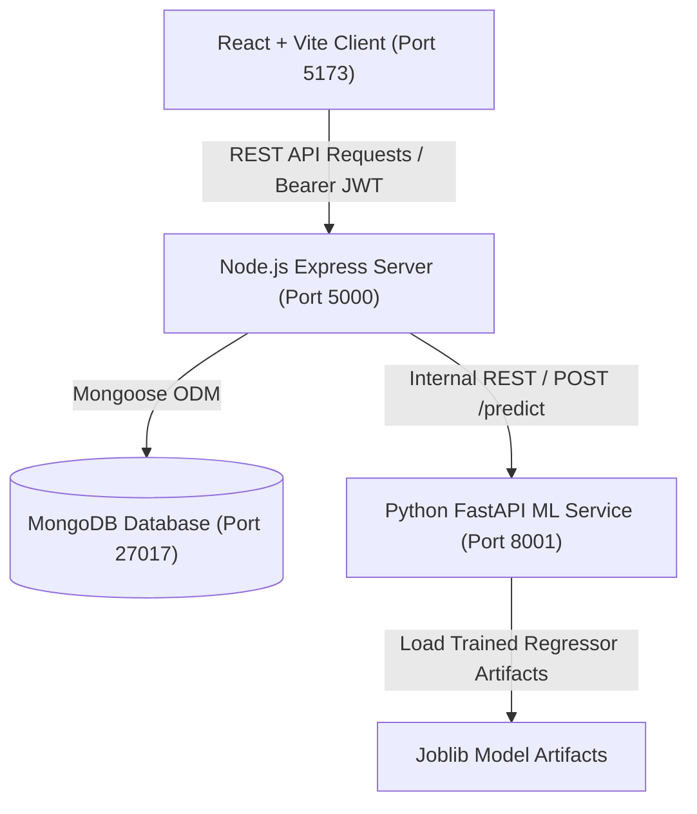

# CampusCart AI — System Architecture

## 1. High-Level Architecture Overview

CampusCart AI is designed as a decoupled, multi-tier system uniting:
1. **React + Vite Frontend (SPA)**: Modern, responsive interface styled with Tailwind CSS, Lucide icons, and Recharts.
2. **Node.js + Express REST API Backend**: Central business logic, MongoDB Mongoose ODM, JWT authentication, and secure file handling.
3. **Python FastAPI ML Microservice**: Demand forecasting engine executing scikit-learn regressors and inventory optimization algorithms.
4. **MongoDB Atlas / Local Instance**: ACID-compliant document storage with compound indexing.

---

## 2. Security Architecture

- **Token Authentication**: Short-lived Access Tokens paired with rotating Refresh Tokens.
- **Role-Based Access Control (RBAC)**: Server-enforced middleware restricting endpoints across `STUDENT`, `SHOP_OWNER`, `DELIVERY_AGENT`, and `ADMIN`.
- **Delivery Verification OTP**: Six-digit cryptographically random OTP generated upon order placement. Stored strictly as a salted SHA-256 hash. The physical courier inputs the student's OTP to trigger status completion.
- **Private Document Isolation**: Uploaded print PDFs are stored in non-public file storage with random hash names. Downloads are streamed strictly through authenticated routes verifying identity.

---

## 3. Communication Contract

- **Frontend to Express**: JSON payloads over HTTP with Authorization headers.
- **Express to FastAPI**: Internal service-to-service JSON communication with configurable timeout and high-fidelity fallback to statistical rolling baseline if the ML service is temporarily unreachable.
